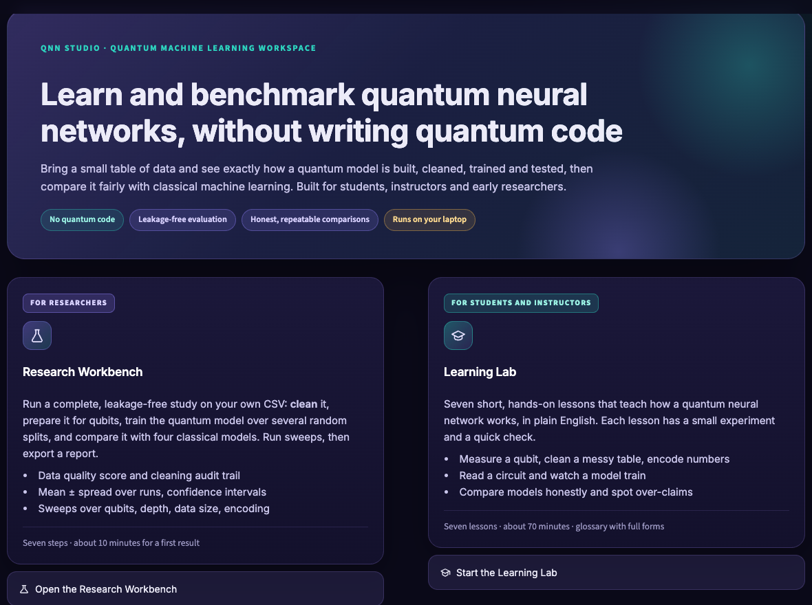
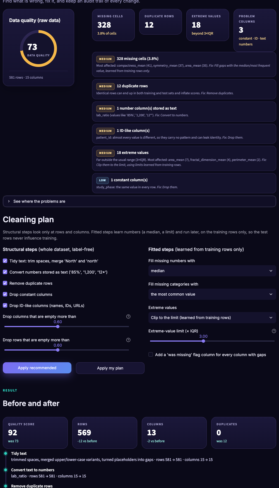
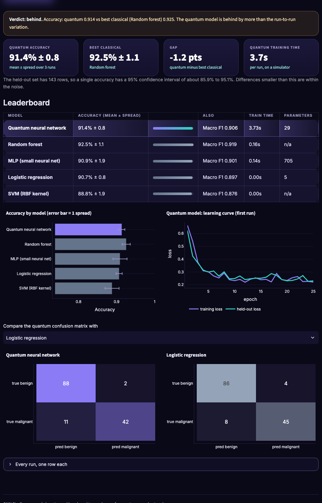
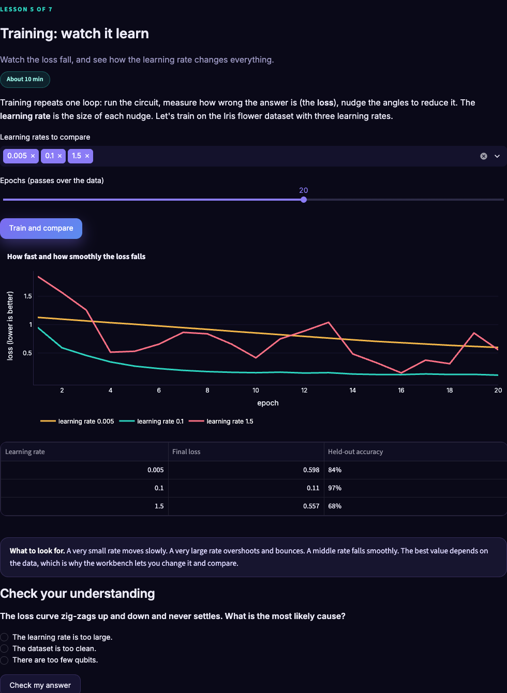

# QNN Studio

**A no-code workspace to learn and benchmark quantum neural networks.**
Bring a small table of data, see exactly how a quantum model is cleaned, built, trained and tested, and compare it fairly with classical machine learning. No quantum programming needed.



## The use case

Two things make quantum neural networks (QNNs) hard to try: they need specialist skills, and real datasets are bigger than today's quantum machines. QNN Studio hides the first and shrinks the second, so what is left is the question that matters: **is a quantum model any good on my data?**

It has two workspaces, one for each audience:

| | Research Workbench | Learning Lab |
|---|---|---|
| For | researchers and early-stage studies | students and instructors |
| Does | a complete, leakage-free study on your own CSV | seven short hands-on lessons with quizzes |
| Output | verdict, leaderboard, sweeps, exportable report | understanding, with a glossary of full forms |

## Quick start

```bash
python3 -m venv .venv && source .venv/bin/activate
pip install -r requirements.txt
streamlit run app.py
```

## Research Workbench: seven steps

1. **Data**: upload a CSV or load a curated dataset (including a deliberately messy clinical table). Target and task are detected for you.
2. **Clean**: a 0 to 100 data-quality score, a prioritised problem list, one-click fixes and an audit trail of every change (duplicates, gaps, numbers stored as text, ID-like and constant columns, extreme values).
3. **Prepare**: split first, then fit everything that learns from data on the training rows only: gap filling, outlier limits, scaling, PCA or feature selection. Optional Medical profile.
4. **Model**: choose the encoding (angle, amplitude, IQP), the circuit type and the depth. See the circuit before you train it.
5. **Train and compare**: the quantum model and four classical models (logistic or ridge regression, SVM, small neural net, random forest) over several random splits, with a plain-English verdict.
6. **Experiments**: sweep qubits, depth, training-set size, encoding or circuit type, with a spread at every point.
7. **Report**: Markdown report, per-run CSV and a settings file, so the study can be repeated.




## Learning Lab

Measure a qubit, clean a messy table, turn a number into a qubit angle, read a circuit and count its adjustable angles, watch three learning rates train, compare models honestly, and spot over-claims. Each lesson ends with a question, and a searchable glossary spells out every acronym.



## Why the results can be trusted

* **No data leakage.** Gap filling, scaling, PCA and outlier limits are learned from training rows only and then applied to the held-out rows (`qnn_platform/workflow.py`, tested in `tests/test_workflow.py`).
* **Spread, not luck.** Every number is a mean over several random splits with its spread, plus a confidence interval.
* **Honest verdicts.** "Ahead", "comparable" or "behind" comes from a *paired* 95% confidence interval over the runs. The tool never claims a quantum advantage on its own.
* **Audit trail.** Every cleaning step records rows and columns before and after. Reports include seeds and settings.

Benchmark on five datasets (5 random splits each) is stored in `data/benchmark_results.json` and reproduced with:

```bash
python scripts/run_benchmark.py        # about 5 minutes
```

## Layout

```
app.py                     router and navigation
views/home.py              use case, evidence, safeguards
views/research.py          Research Workbench
views/learning.py          Learning Lab
qnn_platform/
  cleaning.py              data profiling, quality score, structural + fitted cleaning
  workflow.py              leakage-free preparation, studies, sweeps, verdicts
  quantum_model.py         PennyLane circuits wrapped as PyTorch layers
  classical_model.py       classical baselines
  demo_data.py             curated and lesson datasets
  ui.py                    design system
  lab_content.py           glossary and lesson list
data/benchmark_results.json
scripts/run_benchmark.py
tests/                     pytest suite (unit and end-to-end page tests)
```

An optional, separate quantum image classification demo is in `image_dashboard.py` (`streamlit run image_dashboard.py`).

## Tests

```bash
pip install -r requirements-dev.txt
pytest
```

## Limits and responsible use

Quantum circuits run on a classical **simulator**, not on quantum hardware. The datasets are small and public, and results may not carry over to other data. QNN Studio is for learning and research: do not use its output for clinical, financial or safety decisions. No user study has been run yet, so the learning benefit is a plan, not a measurement. A "comparable" result is not evidence of quantum advantage.

## Sources behind the use case

Bowles, Ahmed, Schuld (2024) *Better than classical?* [arXiv:2403.07059](https://arxiv.org/abs/2403.07059) · Kölle et al. (2023) [arXiv:2311.05559](https://arxiv.org/abs/2311.05559) · Leither et al. (2026) [arXiv:2608.11373](https://arxiv.org/abs/2608.11373) · Schuld, Killoran (2022) [arXiv:2203.01340](https://arxiv.org/abs/2203.01340) · Preskill (2018) [arXiv:1801.00862](https://arxiv.org/abs/1801.00862) · [Terra Quantum TQ42 Studio](https://thequantuminsider.com/2025/04/14/terra-quantum-launches-tq42-studio-supports-no-code-quantum-ai-development-in-closed-beta/) · [Bloq Quantum](https://quantumcomputingreport.com/bloq-quantum-launches-no-code-platform-to-accelerate-algorithm-development/)
